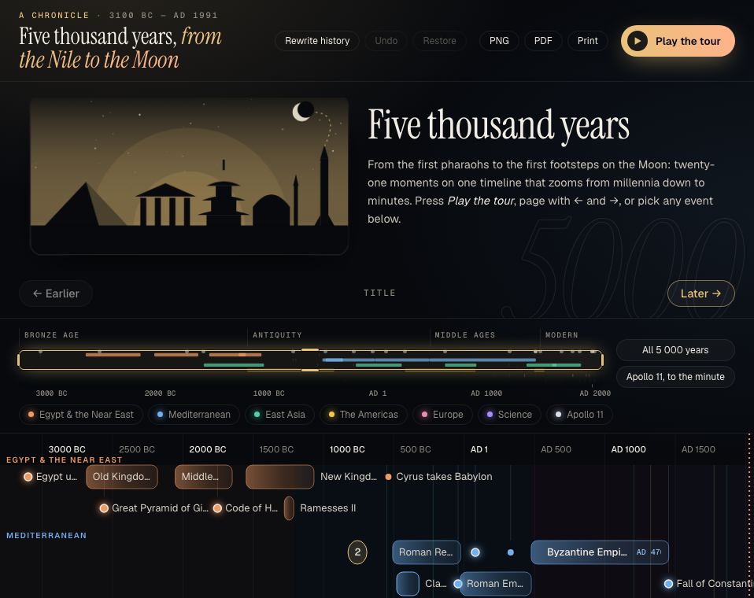

# Temporeum Timeline

[](https://github.com/horakdani/Temporeum_timeline_SDK/actions/workflows/ci.yml)
[](https://www.npmjs.com/package/@temporeum/timeline-element)
[](packages/core/package.json)
[](LICENSE)

An editable, accessible, responsive timeline for the web, covering spans from millennia down to seconds. Lanes never collide, every gesture has a keyboard equivalent, it renders on the server, and the engine has **zero runtime dependencies**.

[](https://horakdani.github.io/Temporeum_timeline_SDK/)

**[Live demo and documentation →](https://horakdani.github.io/Temporeum_timeline_SDK/)**

```bash
npm install @temporeum/timeline-element
```

```js excerpt:example/quick-start
import { createTimeline, registerPlugin } from "@temporeum/timeline-element";
import { groupsPlugin } from "@temporeum/timeline-element/groups";

// Rows with a visible name are groups, a plugin: registered once, before the first timeline.
registerPlugin(groupsPlugin);

const items = [
  { id: "design", start: new Date("2026-03-02"), end: new Date("2026-03-09"), label: "Design", laneId: "work" },
  { id: "launch", start: new Date("2026-03-27"), end: new Date("2026-04-03"), label: "Launch", laneId: "ship" },
];
const groups = [
  { id: "work", label: "Work" },
  { id: "ship", label: "Shipping" },
];

const log = document.querySelector("#log");
const timeline = createTimeline(document.querySelector("#timeline"), {
  items,
  groups,
  ariaLabel: "Release plan",
  editing: { enabled: true, snapMs: 86_400_000 },
});

// The library never saves: an edit comes out as a command, and it is yours.
timeline.on("itemMoved", ({ item, to }) => {
  log.textContent = `${item.label} now starts ${new Date(to.start ?? item.start).toDateString()}`;
});
```

The page needs a `<div id="timeline" style="height: 300px">` and a `<p id="log">`. [Getting started](https://horakdani.github.io/Temporeum_timeline_SDK/getting-started.html) goes on from here; the [frameworks page](https://horakdani.github.io/Temporeum_timeline_SDK/frameworks.html) has the same in React, Vue, Svelte and Angular.

## Try it

The documentation site runs every example live: the timelines on its pages are the library, not pictures of it — the [home page's chronicle](https://horakdani.github.io/Temporeum_timeline_SDK/) of five thousand years, the [showcase](https://horakdani.github.io/Temporeum_timeline_SDK/showcase.html), the recipes and the guides, each with its example running.

To run the site on your own machine (Node 22.12 or later):

```bash
npm ci
npm run build -w @temporeum/timeline-docs
npm run serve -w @temporeum/timeline-docs
```

Then open <http://localhost:41737/site/>.

## Why another timeline

Read-only timeline widgets already exist. This one is built to have five properties at once:

- **Editable.** You can drag and resize items. Each edit comes out as a command, and the command's `inverse` undoes it.
- **Genuinely responsive.** On a narrow screen the timeline turns vertical. That layout comes from the same code as the horizontal desktop one: the container's width decides, not a separate build.
- **Accessible.** Every gesture has a keyboard equivalent, and screen readers see the timeline as a listbox. The docs site and the demo pages are checked against WCAG 2.2 AA with axe, with 0 violations.
- **Light.** The engine does its own scale and tick maths and depends on nothing. A plain timeline's page loads 58.4 kB of JavaScript minified and gzipped, a Gantt chart's 66.3 kB; vis-timeline's standalone build is 155.8 kB. What a page does not use is a plugin it never downloads. The `<script>` tag's UMD file is the exception: it carries every plugin, nearly twice a plain timeline's page, so a page that minds its bytes imports the modules.
- **Typed.** The public surface has no `any`, and CI enforces it.

## How it compares

The [benchmark](https://horakdani.github.io/Temporeum_timeline_SDK/benchmark.html) runs this library and vis-timeline 8.5.6 on the same data, in the same browser, with real mouse input, on Chromium with a 4× CPU slowdown. Results for 10 000 items:

| | Temporeum | vis-timeline |
|---|---|---|
| First render | 0.26 s | 3.58 s |
| Missed frames while panning | 0.4% | 58% |
| Missed frames while zooming (ctrl + wheel) | 3% | 65% |
| JavaScript heap after load | 6.7 MB | 37.5 MB |

The benchmark page also lists where we lose. At this density (about 2 000 items across 1 440 px) Temporeum draws no item text, while vis-timeline draws labels on fewer, larger items. Up to about 1 000 items per screen width, labels that don't fit are shortened with an ellipsis instead of being dropped.

## Packages

| Package | What it is for |
|---|---|
| [`@temporeum/timeline-element`](packages/web-component) | `createTimeline` (the live timeline), `<temporeum-timeline>` (the custom element), and server rendering. **Start here.** |
| [`@temporeum/timeline-react`](packages/react) | `<Timeline>` and `useTimelineState` for React 18 and 19. |
| [`@temporeum/timeline-vue`](packages/vue) | `<Timeline>` and `useTimelineState` for Vue 3. |
| [`@temporeum/timeline-svelte`](packages/svelte) | `<Timeline>` and `timelineState` for Svelte 5. |
| [`@temporeum/timeline-angular`](packages/angular) | `<tl-timeline>` and `timelineState` for Angular, standalone and zoneless. |
| [`@temporeum/timeline-core`](packages/core) | The engine: geometry, layout, rendering, input, keyboard, loading and clustering. It needs no DOM, so you can build your own shell on it. |

All six packages are released together, always share one version, and follow [semantic versioning](https://horakdani.github.io/Temporeum_timeline_SDK/stability.html).

## Coming from vis-timeline?

[The migration guide](https://horakdani.github.io/Temporeum_timeline_SDK/guides/migrating-from-vis-timeline.html) maps vis-timeline options to their equivalents here, with a running example for each. It also lists, honestly, what is not here yet.

## Contributing

Issues and pull requests are welcome; read [CONTRIBUTING.md](CONTRIBUTING.md) first. Security reports go through [SECURITY.md](SECURITY.md), not public issues. [GOVERNANCE.md](GOVERNANCE.md) explains how decisions are made, and [RELEASING.md](RELEASING.md) how a release happens.

## License

[MIT](LICENSE)
